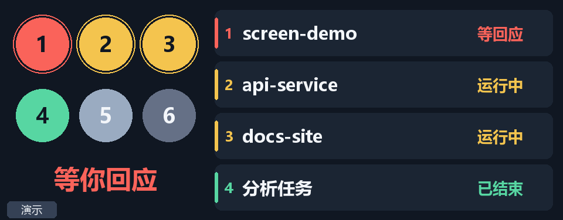

# Agent 信号站 — 乔思伯 DS339

把 Windows 主机上已有的 **DS339 黑色（3.39 英寸、376×960）** 用作 Codex / Claude Code 状态屏。
横向画面为 960×376。使用已安装的乔思伯 USB 驱动，不刷固件，不安装远程客户端，也不调用模型判断状态。



## 安装

需要 Windows 10/11 x64、64 位 Python 3.11+（`python` 在 PATH 中），以及原厂已安装的
DS339 `libusb0` 驱动。只使用这个组件不需要编译上游 WPF 应用。

```powershell
# 只检出小屏组件，保留 fork 的 Git 历史
git clone --filter=blob:none --sparse https://github.com/gongyuhang2023-cpu/infopanel-1.git
cd infopanel-1
git sparse-checkout set agent-screen
```

## 日常使用

从仓库根目录执行以下命令；首次启动会准备独立 Python 环境。登录自启需另行启用，见下节。
如果仍安装了 JONSBO-AIO，先从系统托盘退出它；两个程序不能同时控制屏幕。

```powershell
# 启动，后台运行，不弹终端窗口
powershell.exe -NoProfile -ExecutionPolicy Bypass -File .\agent-screen\Start-Screen.ps1

# 停止，关闭屏幕输出并释放 USB
powershell.exe -NoProfile -ExecutionPolicy Bypass -File .\agent-screen\Stop-Screen.ps1

# 查看状态：USB 是否连接、已发送帧数、最后错误
.\.local\agent-screen-venv\Scripts\python.exe .\agent-screen\screen.py status
```

启动脚本在 `.local/agent-screen-venv/` 创建独立 Python 环境。需要 Python 3.11+、
Windows 10/11 x64，以及原厂已安装的 `libusb0` 驱动。依赖见 `requirements.txt`。
所有个人状态、预览图、日志和测试记录都在 git-ignored 的 `.local/`。
登录自启只在当前用户启动文件夹新增 `Agent Signal - DS339.lnk`；不修改 PATH、桌面快捷方式或系统服务。

- 图像预览：`.local/agent-screen/frame.png`
- 运行状态：`.local/agent-screen/status.json`
- 运行报错：`.local/agent-screen/stderr.log`
- 画面倒置：停止后用 `Start-Screen.ps1 -Rotation 270` 启动；默认 `90`。
- 回到原厂显示：先停止 Agent 信号站，再启动 JONSBO-AIO。

## Windows 登录自启

```powershell
# 注册当前用户的静默登录自启，不需要管理员权限
powershell.exe -NoProfile -File .\agent-screen\Set-Autostart.ps1 -Action Enable

# 查看入口及命令
powershell.exe -NoProfile -File .\agent-screen\Set-Autostart.ps1 -Action Status

# 关闭自启：只移除本组件自己的快捷方式，并先备份到 .local/
powershell.exe -NoProfile -File .\agent-screen\Set-Autostart.ps1 -Action Disable
```

入口放在当前用户的 Windows Startup 文件夹，隐藏窗口调用 `Start-Screen.ps1`。
它在**登录 Windows 后**启动，不是登录前的系统服务。入口实际启动已验证；不通过重启主机来测试。
移动项目目录后，应在原目录关闭自启，再从新目录重新启用。

如果原厂软件仍有自启项，请先在原厂软件或 Windows 设置中关闭，避免两个程序争用屏幕。
保留屏幕驱动；本组件不捆绑或自动替换驱动。

## 灯的含义

| 灯 | 意义 |
|---|---|
| 红 | 等待回复／授权，或发生执行异常；以文字区分 |
| 黄 | 正在处理本轮任务 |
| 绿 | 本轮回复已结束，结果待查看；不代表成果已通过验收 |
| 灰 | 空闲，或长时间没有新事件、状态待确认 |

左侧**一个圆点对应一个会话**，按数量自动缩放：1 个为大圆，2 个并排，3～4 个排两行，
5～6 个缩小后排两行。圆点内编号对应右侧栏目，圆点下不显示项目名。
每行按相同的列对齐：3 个时第 3 个在左下，5 个时第 4、5 个在左下和中下，不居中补齐末行。
右侧最多 4 行，只显示对话名称和状态；Agent 类型、计时、更新时间和短 ID 都已去掉。
对话名称优先用 `/rename` 设定的名字，其次是 Claude Code / Codex 自动生成的标题，都没有时用项目目录名。
要改名，在该对话里输入 `/rename 新名字`。Claude Code 没改过名时，自动标题会随话题变化；放不下的名字以“…”截断。
少于 4 行时保持宽松布局。
左侧大字仍概括整体状态。顶部标题和时钟、底部颜色图例及大字下的常驻小字均已去掉。

按“等待回应 → 异常 → 运行 → 本轮结束 → 待确认 → 空闲”排序，空闲会话不会挤掉工作中的会话。
超过 6 个时，只在左侧大字下显示“另有 X 个会话”，数量为总数减去 6。
同优先级位置稳定；收到明确 `SessionEnd` 的已关闭会话退出列表。

终端会话还会绑定所属 Codex / 原生 Claude 进程及其创建时间。进程退出后数秒内移除对应会话，
不必等待完成提示超时；即使 `SessionEnd` 缺失也能清除。PID 被复用、检查权限不足或另一所属进程仍运行时，
不会误判为退出。没有会话时显示“无 AI 会话”，不保留圆点和任务行。
这是终端进程的退出检测，不等同于桌面应用内关闭标签页或切换对话。

异步问题提出后，其他工具继续运行也不会把红灯盖掉；用户回答后恢复运行。
一个子 Agent 结束不会把父会话标成完成。
单次工具调用失败（命令非零退出、搜索超时等）由 Agent 自行处理，仍显示运行中，不亮红灯；
包括父会话已结束本轮、后台子 Agent 仍在运行的情况。执行异常只对应 Claude Code 本轮因 API 错误等中止
（`StopFailure`），红灯保持到下一次提问。

运行状态 10 分钟无新事件变为“状态待确认”；等待回应和执行异常 1 小时无新事件也变为待确认。
没有绑定活进程的历史记录，完成提示保留 10 分钟、空闲条目保留 1 分钟后退出；
已确认终端仍打开的会话保留状态，随终端退出清除。不把最近一天的历史记录当作仍打开的任务。
尚未结束的工作长时间无更新仍显示“状态待确认”，不会按已完成历史清走。**没有更新绝不推断成完成。**
界面不显示时钟或计时。怀疑画面不更新时，检查后台进程和 `status.json` 中的 `updated`。

## Agent 接入

两种来源共同工作：

1. **已运行会话**：只在本机读取最近一天的 Codex / Claude Code JSONL 记录，提取生命周期、
   项目名、对话名、会话 ID 和时间；Codex 对话名取自 `~/.codex/session_index.jsonl`。
   日志格式不属于稳定接口，属于补充监测。
2. **正式 hooks**：记录提交、执行工具、权限请求、本轮结束或异常中止、中断等事件。只观察，不改变权限决定，
   失败时静默放行。状态数据库不保存提示词、工具参数或回答正文；
   只额外保存 Agent 自己记录的对话名，自动标题由对话内容概括而来。
3. **终端存活检测**：hooks 用 Windows 只读进程信息绑定 PID 和创建时间；后台检查已绑定进程是否退出。
   对已打开的 Codex 终端，后台也可通过其已打开的会话日志建立绑定。无法读取进程信息时保留未知状态。

安装或重新安装 hooks（默认只预览，加 `--apply` 才写配置）：

```powershell
.\.local\agent-screen-venv\Scripts\python.exe .\agent-screen\configure_hooks.py
.\.local\agent-screen-venv\Scripts\python.exe .\agent-screen\configure_hooks.py --apply
```

安装会追加到 `%USERPROFILE%\.codex\config.toml` 与 `.claude\settings.json`。
其他设置及 hooks 保留。原文件分别备份在这两个配置目录内的 `backups/agent-screen/`，
不会复制到本仓库。Codex 写进本组件区块内的 hook 信任记录会保留；内容等价的文件不改写、不备份。

Codex 新 hooks 需要在 `/hooks` 中信任后才会执行。事件分组内的命令含
`agent-screen/screen.py`。旧会话可能继续使用启动时的配置；新会话加载新 hooks。
Claude Code 同样应在新会话中验证加载。hooks 使用主机 PATH 中已有的 `python`，
其入口只依赖 Python 标准库。

移除本组件的 hooks，保留其他 hooks 和设置：

```powershell
.\.local\agent-screen-venv\Scripts\python.exe .\agent-screen\configure_hooks.py --remove --apply
```

然后结束本组件后台进程；不需要删文件或卸载原厂驱动。

## 验证

```powershell
.\.local\agent-screen-venv\Scripts\python.exe -m unittest discover -s .\agent-screen -p test_screen.py -v
.\.local\agent-screen-venv\Scripts\python.exe .\agent-screen\screen.py doctor
```

演示与真实数据分开：

```powershell
# 只生成预览图，不访问 USB
.\.local\agent-screen-venv\Scripts\python.exe .\agent-screen\screen.py --data-root .\.local\screen-demo preview

# 六会话硬件演示：先停止真实后台进程。演示图带明显标记，不写入真实会话数据库。
.\.local\agent-screen-venv\Scripts\python.exe .\agent-screen\screen.py --data-root .\.local\screen-demo demo --usb --seconds 30
```

2026-10-09 验证范围：在一块 DS339 上确认 EDID、USB 输出、横向画面和真实 Codex 多会话状态，
异步提问可触发红灯。已检查 0、1～6、8 个会话布局，23 项 Python 测试通过，
包含用真实的无害测试进程验证“完成后退出且没有结束 hook”会清空显示。
启动脚本在 PowerShell 5.1/7 下检查过，登录自启入口已实际启动验证；未通过重启验收完整登录流程。
Claude Code 的注册命令通过模拟事件验证，真实 Claude 会话尚待确认。
机器配置、运行数据库、日志和验收原始记录不随源码发布。

## 实现与来源

`ds339.py` 将 InfoPanel 的 DS339 USB 通信部分移植为 Python，复用原厂驱动。
发送前校验 EDID 和唯一设备，只接受 376×960 面板。设备断开后定期重连；原厂程序正在运行时不接管。
单实例互斥防止本组件的两个进程争抢屏幕。

`state.py` 管理状态；`watch.py` 读取已有会话；`process_owner.py` 检查终端进程；
`render.py` 生成画面；`screen.py` 负责运行。
完整来源、许可证和上游版本见 [NOTICE.md](NOTICE.md)。本组件采用 GPL-3.0。

本组件发布在 [gongyuhang2023-cpu/infopanel-1](https://github.com/gongyuhang2023-cpu/infopanel-1)
的 `agent-screen/`，原有 InfoPanel 源码与历史保留。Python 界面和状态逻辑可以独立修改运行。
